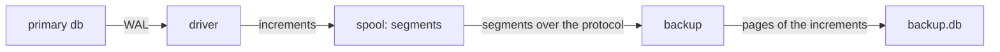

# SQLite Relay

SQLite Relay keeps a second copy of a live SQLite database in sync. The primary side reads the committed transactions out of the write-ahead log of the primary database, writes them into a durable spool as a chain of immutable segments and pushes the segments to the backup side, which applies the pages of the increments into a plain SQLite file that is a copy of the primary database. The repository ships Go packages and one example program, `examples/relay`, that runs both sides of a relay in one process. There is no relay binary to install: an application embeds the packages and owns the process, the listener and the deployment.

The two sides share one chain of segments. The chain carries an **epoch** (its generation) and **sequence numbers** (the counter of the transactions of the chain). The driver turns the committed transactions of the log into **increments**, the **spool** stores them in **segments**, and the protocol server of the primary side pushes the segments to the backup side.



## When to use it

- **A hot backup on another machine.** A local SQLite database that has to
  survive the loss of the host holds a copy on another machine. The primary
  side pushes every committed transaction to the backup side as soon as it
  has captured it, and the business never waits for the network.
- **A standby copy for a reader.** A report or an analytics program reads a
  copy of the database while the application keeps writing. The backup is
  paused, the program reads the file of the backup database and the backup
  is resumed. The primary side keeps capturing while the backup is paused,
  so the copy catches up with the primary afterwards.
- **An offsite copy for disaster recovery.** The backup runs at another site
  and survives a network outage: it reconnects on its own and continues at
  the sequence number it applied, and the segments the backup did not
  acknowledge stay in the spool of the primary side.

## When not to use it

- **Not a multi-writer setup.** The driver has to be the only component that
  writes to the primary database. A second writer, a second process on the
  same file or a connection of your own breaks the continuity of the
  increments, and the relay cannot tell the transactions of the two apart.
- **Not a replication mechanism with consensus.** The protocol serves one
  source and one backup, the shared token of the deployment is the only
  credential, and there is no quorum, no leader election and no resolution
  of a conflict.
- **Not a live-queryable replica.** The relay writes the file of the backup
  database while the backup is in sync, so a reader that opens it in that
  moment can see a torn page. The backup has to be paused before the file is
  read.
- **Not a point-in-time-recovery tool.** The backup keeps no history: a
  snapshot replaces the old backup database, so the backup holds the state
  of the chain and not a series of points in time.

## Installation

```bash
go get github.com/cnlangzi/sqlite-relay@main
```

The repository carries no tag, so the version query is needed: `go get`
without one asks for the latest release and the module has none. The query
resolves a pseudo-version of the default branch.

The `go.mod` of the consuming program needs the `replace` of the fork:

```go.mod
replace github.com/mattn/go-sqlite3 => github.com/cnlangzi/go-sqlite3 v1.14.53-relay.1
```

The `replace` has to sit in the main module of the consuming program. A
`replace` of a dependency is ignored, so a `replace` inside a module that is
only a dependency of the program has no effect.

The fork carries its own module path, so the requirement of the upstream path
has to be there as well, and `go mod tidy` cannot place it:

```bash
go get github.com/mattn/go-sqlite3
```

That command adds the requirement and the entries of the `go.sum`.
`go mod tidy` reports that the fork is used for two different module paths
and it changes nothing, so the `go.mod` of the consuming program keeps the
requirement by hand. The `go.mod` of this repository does the same.

The reason for the `replace` is the WAL hook. The driver installs it on every
connection it opens (`RegisterWalHook` in `driver/connection.go`) and reads the
committed transactions out of the write-ahead log through it. The hook exists
only in the fork: upstream `mattn/go-sqlite3` v1.14.53 does not carry it, so
the program does not compile without the `replace`.

The toolchain is Go 1.27 or later, the version of the `go 1.27` directive of
the `go.mod` of this repository.

## Quick start

Both sides read the shared token of the deployment from a file. The file has
to exist, it must not be empty and both sides have to hold the same bytes:
the handshake proves it with a message authentication code.

### The primary side

The primary side owns the primary database, its spool and the protocol
server.

```go
drv, err := driver.Open(ctx, driver.Config{
    DSN: "file:/var/lib/app/app.db?_journal_mode=WAL",
})
if err != nil {
    return err
}
defer drv.Close()

peer, err := source.Open(ctx, source.Config{
    Driver: drv,
    Spool: spool.Config{
        Root: "/var/lib/relay/spool",
        Mode: spool.ModeNormal,
    },
    Protocol: protocol.Config{
        TokenFile:  "/etc/relay/token",
        DatabaseID: "app.db",
        StreamID:   1,
    },
    SnapshotDir: "/var/lib/relay/snapshots",
})
if err != nil {
    return err
}
defer peer.Close()

ln, err := net.Listen("tcp", ":9000")
if err != nil {
    return err
}
return peer.Run(ctx, ln)
```

The application closes the source runtime first and the driver second. The
runtime captures the transactions that are still pending, writes them into the
spool and marks the chain of the segments as complete, and it can only do
that while the write-ahead log of the primary database is still there: the
driver removes the log when it closes its last connection. The application
stops writing to the primary database before it closes the runtime, because a
transaction that is committed afterwards is not in the chain.

### The business code

Every read and write of the business goes through `drv.DB()`. A connection
that the application opens itself with `sql.Open("sqlite3", ...)` is outside
of the contract: it carries no WAL hook and the driver does not know about
it. The driver notices that the frames of the write-ahead log were written
back without its acknowledgement and stops with an error that names
`nBackfill`.

```go
db := drv.DB()
```

### The backup side

The backup side owns the copy of the primary database.

```go
peer, err := backup.Open(ctx, backup.Config{
    Root: "/var/lib/relay/backups",
    Protocol: protocol.Config{
        TokenFile:  "/etc/relay/token",
        DatabaseID: "app.db",
        StreamID:   1,
        BackupID:   "backup-1",
    },
})
if err != nil {
    return err
}
return peer.Run(ctx, "10.0.0.5:9000")
```

`Run` reconnects on its own with a growing backoff, so the caller does not
wrap it in a reconnect loop.

### Pause and resume

The backup is paused before another program reads the file of the backup
database. After `Pause` the file `<Root>/<DatabaseID>/backup.db` belongs to
the business until `Resume`, and the relay does not write it while the
backup is paused.

```go
if err := peer.Pause(ctx); err != nil {
    return err
}
// the business may read /var/lib/relay/backups/app.db/backup.db
if err := peer.Resume(ctx); err != nil {
    return err
}
```

## On-disk layout

The spool of the primary side, below `spool.Config.Root`:

```text
<Root>/<DatabaseID>/
  segments/%016d-%016d.seg   # the published segments (seqStart, seqEnd)
  tmp/%016d.tmp              # the segments that wait for the barrier
  state/stream.json          # the identity of the database, the epoch, the next seq
  state/capture.json         # the durable capture acknowledgement: seq and WAL position
  peers/<peer-id>.ack        # the acknowledgement of the backup: seq and epoch
```

The backup database of the backup side, below `backup.Config.Root`:

```text
<Root>/<DatabaseID>/
  backup.db       # the backup database
  backup.db.new   # the snapshot that is on its way
  state.json      # the state of the backup
```

## Operations and monitoring

| Source | Counter | Meaning |
|---|---|---|
| `source.Peer.Stats()` | `LagSeq` | the sequence numbers the backup did not acknowledge yet |
| `source.Peer.Stats()` | `Lag` | the time since the last acknowledgement of the backup |
| `source.Peer.Stats()` | `SpoolFull` | the spool reached its limit and the capture stands still |
| `source.Peer.Stats()` | `SnapshotRequired` | the chain is broken and the backup needs a new baseline |
| `source.Peer.Stats()` | `SnapshotReason` | why the chain is broken |
| `source.Peer.Stats()` | `Resyncs` | the resyncs the source asked the backup for |
| `source.Peer.Stats()` | `Connected` | a backup is on the line |
| `source.Peer.Stats()` | `LastError` | the description of the last failure |
| `backup.Peer.Stats()` | `Attempts` | the connections opened since the backup started |
| `backup.Peer.Stats()` | `ApplyErrors` | the transactions that could not be applied |
| `backup.Peer.Stats()` | `CorruptSegments` | the segments that did not hold what they said |
| `backup.Peer.Stats()` | `SnapshotRequired` | the number of the times the backup asked for a snapshot |
| `backup.Peer.Stats()` | `LastError` | the description of the last failure |
| `source.Peer.Stats().Spool` (`spool.Stats`) | `Bytes` | the bytes the spool holds on the disk |
| `source.Peer.Stats().Spool` (`spool.Stats`) | `UnackedBytes` | the bytes of the published segments the backup did not acknowledge |
| `source.Peer.Stats().Spool` (`spool.Stats`) | `UnackedAge` | the age of the oldest segment the backup did not acknowledge |
| `source.Peer.Stats().Spool` (`spool.Stats`) | `Warn` | the spool holds more bytes than it should |
| `source.Peer.Stats().Spool` (`spool.Stats`) | `DiskFreeBytes` | the bytes left on the file system of the spool |
| `source.Peer.Stats().Spool` (`spool.Stats`) | `Broken` | the chain of the segments has a hole |
| `source.Peer.Stats().Spool` (`spool.Stats`) | `BrokenReason` | why the chain of the segments is broken |

The spool of the primary side grows while the backup is offline: the source
keeps the segments the backup did not acknowledge. `spool.Config.MaxBytes` is
the brake: the spool refuses the transactions that do not fit into it.
`spool.Config.WarnBytes` is the line the spool warns about, and
`spool.Stats.Warn` reports that the spool is over it.

A full spool stops the capture without stopping the business. The runtime
keeps the transactions that do not fit into the spool and writes them as soon
as the spool has room again. It hands no capture acknowledgement to the
driver in the meantime, so the frames of the write-ahead log stay in the log.

## Caveats

1. **Only the driver may write to or checkpoint the primary database.** A
   connection of your own or a checkpoint from the outside makes the driver
   stop with an error that names `nBackfill`, because the frames of the log
   were written back without its acknowledgement: the increments that follow
   are not trustworthy and the consumer needs a new snapshot. A second
   process on the same file commits transactions the driver cannot tell
   apart from its own, so the capture is not complete and the backup misses
   them. A `PRAGMA wal_autocheckpoint` on a managed connection replaces the
   WAL hook of that connection: the driver puts the hook back, but the frames
   that were written back in the meantime are gone from the log.
2. **Do not write to the primary database while the source runtime is
   closed.** The chain of the segments has to cover the primary database when
   the runtime closes. A transaction that is committed afterwards is not in
   the chain, the write-ahead log that holds it is reset when the driver
   closes and the runtime cannot see it: the backup needs a new baseline.
3. **One backup per database.** The protocol serves one backup at a time and
   the distribution of the segments of the chain among several backups is not
   part of the protocol.
4. **Pause the backup before another program reads the backup database.** The
   relay writes the file of the backup database while the backup is in sync,
   so a reader that opens it in that moment can see a torn page.
5. **Do not write to the backup database.** A write of the business is not
   part of the chain and it is lost with the next snapshot. A business that
   needs to write takes a copy of the file and works on the copy.
6. **The backup keeps no history.** The backup does not keep the old
   versions of the backup database: a snapshot replaces it and the old one is
   gone.
7. **The connection is not encrypted.** The handshake proves the shared
   token of the deployment with HMAC-SHA256; there is no TLS and there is no
   certificate. An application that needs an encrypted connection wraps the
   listener it hands to `peer.Run`.
8. **The primary database has to be a file on disk in WAL mode.** A database
   that lives in memory has no WAL and cannot be captured.
9. **The consuming program needs the `replace` of the fork.** See
   [Installation](#installation). Without it the program does not compile.
10. **The tested platform is Linux/amd64 with SQLite 3.54.1**, the version
    `mattn/go-sqlite3` v1.14.53 carries. The library carries no tagged
    release, so its API is not frozen.

## Documentation

- [docs/driver.md](docs/driver.md) — the primary driver: the capture of the
  write-ahead log, the invariants of the managed connections and the
  statistics.
- [docs/source.md](docs/source.md) — the primary side: the capture, the
  acknowledgements, the restart and the continuity of the chain.
- [docs/backup.md](docs/backup.md) — the backup side: the installation of a
  snapshot, the pause and the resume, the state file.
- [docs/protocol.md](docs/protocol.md) — the wire protocol: the handshake,
  the frames, the messages and the reconnection.
- [docs/spool.md](docs/spool.md) — the durable file queue: the segment
  format, the modes of the barrier and the recovery.

## Development

```bash
make build   # compile every package
make tests   # run the tests with the race detector
make e2e     # run the end-to-end tests of the relay
make lint    # check the formatting and run golangci-lint
```

`make tools` installs the pinned golangci-lint.

## License

Apache-2.0, see [LICENSE](LICENSE).
